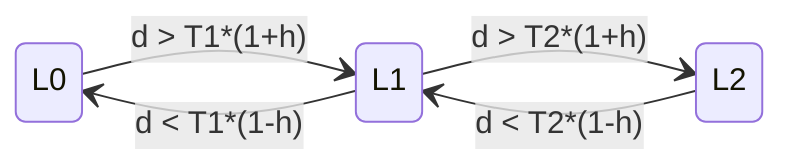

# three-texture-lod

three.js 向けの距離ベース・テクスチャ LOD ライブラリ。カメラ距離に応じて
マテリアルバリアントを差し替え、遠くのオブジェクトほど低解像度テクスチャで描画する。
`WebGPURenderer`（WebGPU / WebGL2 フォールバック）で動作する。

## 方式

解像度の異なる別テクスチャをレベルごとに持ち、カメラ距離に応じて
事前生成したマテリアルバリアントを `mesh.material` へ代入して切り替える。
テクスチャ差し替えではなくマテリアル差し替えにする理由は、
描画パイプライン（シェーダ）をレベル間で共有し、切替時の再コンパイルをなくすためである。

### パイプライン共有の実測結果

デモ（60板・3レベル）で `renderer._pipelines` を観測した実測値（webgpu / webgl 共通）。
基準値は LOD無効の新規ページ（`?lod=0`、ベースマテリアルのみ描画）で数フレーム後に取得し、
有効化後・近↔遠往復後と比較する（caches はページ内でリセットできないため別ページで測る）。

| 時点 | `caches` | `programs.fragment` |
| --- | --- | --- |
| LOD無効時の基準値 | 2 | 2 |
| LOD有効化後（全板に再付与） | 2 | 2 |
| 近↔遠往復後 | 2 | 2 |

切替前後で増加なし。レベルごとにマテリアル実体は別だが、
テクスチャ解像度の違いはパイプラインを分けないことが確認できる。

## 使い方

```ts
import { WebGPURenderer } from 'three/webgpu';
import { MeshStandardMaterial } from 'three/webgpu';
import { createTextureLodSet, TextureLodManager } from 'three-texture-lod';

const renderer = new WebGPURenderer({ canvas, antialias: true });
await renderer.init();

// 解像度の異なる3枚を用意する（色空間・ラップ等の設定は全レベルで統一）。
const base = new MeshStandardMaterial({ map: textureHi, roughness: 0.85 });

const set = createTextureLodSet({
  material: base,
  levels: [
    { distance: 0, textures: { map: textureHi } },
    { distance: 10, textures: { map: textureMid } },
    { distance: 25, textures: { map: textureLow } },
  ],
  hysteresis: 0.1,
});

const manager = new TextureLodManager({ distanceMode: 'surface', residency: 'evict' });
manager.add(mesh, set);

// 毎フレーム、描画前に更新する。
manager.update(camera);
renderer.render(scene, camera);
```

`three-texture-lod` は npm 公開していない private パッケージのため、
利用側では workspace 参照または `file:` 依存で `dist/lib` を参照する。
配布物は `pnpm build:lib` で `dist/lib/` に生成する（JS + 型宣言）。

```sh
pnpm build:lib   # dist/lib/three-texture-lod.js + dist/lib/index.d.ts を生成
pnpm build:all   # デモ（dist/demo/）とライブラリ（dist/lib/）を両方生成し、共存させる
```

## API要約

- `createTextureLodSet(options)` / `TextureLodSet` — 1メッシュ分のLOD定義。
  レベルごとにバリアントマテリアルを事前生成する。`variant(level)` で取得、
  `syncFromBase()` で後付けの材質変更を全バリアントへ反映、`dispose()` で破棄。
- `TextureLodManager` — 複数メッシュのレベル判定と常駐管理。
  `add(mesh, set)` / `remove(mesh)` / `update(camera)` / `levelOf(mesh)` /
  `stats()` / `dispose()`。
- `selectLevel(previous, distance, thresholds, hysteresis)` — ヒステリシス付き判定の純粋関数。
- `computeLodDistance(object, camera, mode)` — 中心距離（`center`）または
  バウンディング球表面からの距離（`surface`、0クランプ）を返す。

## ヒステリシス

境界を `T[i]`（`T[0] = 0`、狭義単調増加）、幅を `h`（`0 <= h < 1`）とする。
初回は `d >= T[i]` を満たす最大の `i` を選び、以降はバンド端を越えた分だけ移動する。

- 上方向: `d > T[level+1] * (1 + h)` の間 `level++`
- 下方向: `d < T[level] * (1 - h)` の間 `level--`



バンドが重ならない条件（`T[i]*(1+h) < T[i+1]*(1-h)`）はセット生成時に検証し、
重なる定義は `Error` で拒否する。

### 設定値の意味

| 設定 | 既定 | 意味 |
| --- | --- | --- |
| `hysteresis` | `0.1` | 境界付近のちらつき抑止幅。`0` で単調なしきい値判定になる |
| `distanceMode` | `'surface'` | `'surface'` は球半径を差し引く。大きな板が目の前にあっても粗LODに落ちない |
| `residency` | `'evict'` | `'evict'` は未使用テクスチャを破棄、`'keep-all'` は全保持 |
| `evictDelayMs` | `5000` | `evict` 時の最終使用からの猶予。`0` で即時破棄 |
| `now` | `performance.now` | 時刻源。テストで時間を操作するための注入点 |

### evict の補足

- 最粗レベル（L2）は常駐（pin）し、破棄対象にならない。遠景でも描画が欠けない。
- `texture.dispose()` は GPU 側のリソースだけを解放し、CPU 側の `image` は残る。
  近景復帰時は再アップロードが走るため、大きなテクスチャではヒッチし得る。
- LOD管理外のメッシュやベースマテリアルが同じ `Texture` を使っている場合、
  `evict` はそのテクスチャも破棄対象にし得る。管理外の利用があるなら `keep-all` を推奨する。
- 事前に全レベルをアップロードしておくウォームアップAPIは用意していない。

### 距離の測り方

- カメラのワールド位置だけを使い、FOV・ズーム・正射影は考慮しない。
- 基準はバウンディング球。`center` は球中心までの距離、`surface` は球面までの距離（0クランプ）。

## 制限

- 判定はオブジェクト単位。`InstancedMesh` のインスタンス単位LODには非対応
  （メッシュ全体の球で1レベルに決まる）。
- 対象スロットは `map` 等の代表的なマップに限定。`colorNode` 等で独自に
  `texture()` を組んでいるマテリアルは `createVariant` フックで個別対応する。
- 圧縮テクスチャの可否はバックエンド依存。レベル間で色空間・フィルタ等の
  設定がずれると警告（`console.warn`）を出す。解像度以外の見え方は統一すること。
- `residentBytes` は RGBA8・ミップマップ係数 4/3 の推定値であり実測ではない。
- デモの `_pipelines` 観測はデバッグ用の内部アクセスであり、公開APIではない。
  three の更新で構造が変わる可能性がある。

## デモ

```sh
pnpm dev            # 動作確認（ブラウザで開く）
pnpm build          # デモアプリを dist/demo/ に出力（dist/lib は残る）
pnpm build:lib      # ライブラリを dist/lib/ に出力（デモは残る）
pnpm build:all      # デモとライブラリの両方を生成し、dist/ 配下に共存させる
```

ブラウザで開き、右上の lil-gui と左上の HUD で操作・観測する。

| 操作 | 内容 |
| --- | --- |
| `autoMove` / `speed` | カメラの自動往復（z: 6 → -70 → 6）と速度 |
| `hysteresis` / `residency` / `evictDelayMs` / `distanceMode` | 設定を丸ごと再構築（カウンタはリセット） |
| `LOD有効` | 全meshの登録／解除（解除時はベースマテリアルに戻る） |
| `近距離へ` / `遠距離へ` | カメラを z=0 / z=30 へ即時移動 |
| `h=0で往復テスト` | ヒステリシスなしで境界 T=10 / 25 を往復 |

URLパラメータ: `?backend=webgl`（WebGL強制）、`?auto=0`（自動移動OFF）、
`?h=0.2`（作成時h）、`?residency=keep-all`、`?z=-30`（初期カメラz）、
`?lod=0`（LOD無効で起動。ベースマテリアルのみ描画）。

## スモーク

```sh
pnpm smoke          # build済み前提。preview起動→検証→kill
```

Playwright（`playwright-core`）が headed Chrome を起動し、
webgpu / webgl の両バックエンドで以下を検証する。
待機は `stats().frame` の進行＋条件ポーリングで行い、固定sleepに依存しない。

1. `__lodDemo.ready` の待機、pageerror / console.error の収集
2. パイプライン基準値を LOD無効の新規ページ（`?lod=0`）で取得し、
   有効化後・近↔遠往復後も `caches` / `fragment` が増えないこと
3. 近距離で `L0` と `L2` が混在し、遠距離で全板が `L2` になること（stats整合つき）
4. ヒステリシス厳密検証（h=0.2, center）:
   `5→L0`, `12.1→L1`, `9→L1`, `7.9→L0`, `9→L0`, `11.9→L0`, `12.1→L1`
   （同じレベルが続くケースもフレームを進めてから読む）
5. バンド内往復（`9.5↔10.5` を10往復）で切替0、対照の h=0 はプローブ単体の系列
   `9.9→L0`, `10.1→L1`, `9.9→L0`, `10.1→L1` で追従すること（`switchCount` は参考記録のみ）
6. テレポート: L0から `setProbeDistance(40)` 1回で frame+2 以内に L2（frame差分を記録）
7. `evict` 即時破棄で `residentBytes` が半分未満に減り、
   近景の中央領域の画素輝度が背景より十分明るい（`> 30`）こと、
   復帰時は `|recovered / near - 1| < 0.1` の両側判定を満たすこと（pngjsで実描画をassert）。
   遠方の輝度は記録のみ
8. `keep-all` では遠ざけても `residentBytes` が減らないこと
9. 近距離・遠距離・evict前後のスクリーンショット保存（`artifacts/`）

結果は JSON で標準出力し、失敗時は exit 1。出力にはパイプライン数、輝度、
`residentBytes`、レベル分布、h=0 / h=0.2 の切替回数を含める。
表示できない環境では
`xvfb-run -a pnpm smoke` のように Xvfb 経由で実行する。
Chrome のパスは `CHROME_PATH` 環境変数で上書きできる
（既定: `/run/current-system/sw/bin/google-chrome`）。
