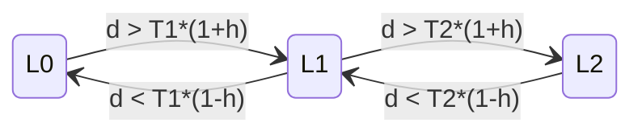
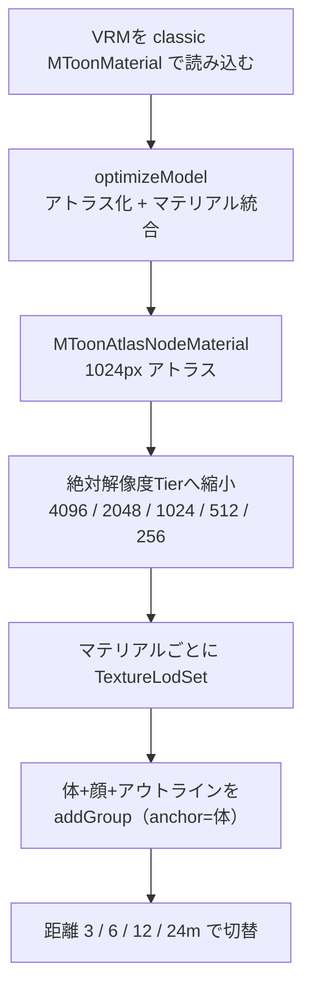

# three-texture-lod

three.js 向けの距離ベース・テクスチャ LOD ライブラリです。カメラからの距離に応じてマテリアルバリアントを差し替え、遠くのオブジェクトほど低解像度のテクスチャで描画します。

`WebGPURenderer`（WebGPU / WebGL2 フォールバック）で動作し、複数メッシュや複数マテリアルを同じ距離で切り替えるグループ管理や、VRM アバターを実行時にアトラス化・LOD 化するデモを備えています。

## 仕組み

レベルごとに解像度の異なるテクスチャを持たせ、事前生成したマテリアルバリアントを `mesh.material` へ代入して切り替えます。テクスチャ単体の差し替えではなくマテリアルごと切り替えることで、描画パイプライン（シェーダ）をレベル間で共有し、切替時の再コンパイルを防ぎます。

### ヒステリシス

距離境界を $T[i]$（$T[0] = 0$、狭義単調増加）、ヒステリシス幅を $h$（$0 \le h < 1$）とすると、初回は $d \ge T[i]$ を満たす最大の $i$ を選び、以降はバンド端を越えた分だけ段階を移動します。

- 遠ざかる向き: $d > T[\text{level} + 1] \cdot (1 + h)$ の間 `level++`
- 近づく向き: $d < T[\text{level}] \cdot (1 - h)$ の間 `level--`



バンドが重ならない条件（$T[i](1 + h) < T[i + 1](1 - h)$）はセット生成時に検証され、重なる定義は `Error` になります。

## 使い方

```ts
import { WebGPURenderer, MeshStandardMaterial } from 'three/webgpu';
import { createTextureLodSet, TextureLodManager } from 'three-texture-lod';

const renderer = new WebGPURenderer({ canvas, antialias: true });
await renderer.init();

// 解像度の異なるテクスチャを用意する（色空間・ラップ等の設定は全レベルで統一）。
const base = new MeshStandardMaterial({ map: textureHi, roughness: 0.85 });

const set = createTextureLodSet({
  material: base,
  levels: [
    { distance: 0, textures: { map: textureHi } },
    { distance: 10, textures: { map: textureMid } },
    { distance: 25, textures: { map: textureLow } },
  ],
  hysteresis: 0.1,
});

const manager = new TextureLodManager({ distanceMode: 'surface', residency: 'evict' });
manager.add(mesh, set);

// 1つの距離で複数メッシュ・複数マテリアルを連動させる場合（VRMの体+顔+アウトラインなど）。
// 全セットの距離境界とヒステリシスは一致させる。remove はグループ全体を解除する。
manager.addGroup(
  [
    { mesh: bodyMesh, set: bodySet },
    { mesh: faceMesh, set: faceSet },
  ],
  { anchor: bodyMesh },
);

// 毎フレーム、描画前に更新する。
manager.update(camera);
renderer.render(scene, camera);
```

このパッケージは npm 公開していない private パッケージのため、利用側では workspace 参照または `file:` 依存で `dist/lib` を参照します。配布物は `pnpm build:lib` で `dist/lib/` に生成できます。

```sh
pnpm build:lib   # dist/lib/three-texture-lod.js + dist/lib/index.d.ts を生成
pnpm build:all   # デモ（dist/demo/）とライブラリ（dist/lib/）を両方生成
```

## 主なAPIと設定

### 公開API

- `createTextureLodSet(options)` / `TextureLodSet`
  1メッシュ分の LOD 定義です。レベルごとにバリアントマテリアルを事前生成し、`variant(level)` で取得できます。同一内容のレベルは同じマテリアル実体を共有するため、`createVariant` フックは共有グループの先頭レベルで 1 回だけ呼ばれます。`canonicalLevel(level)` で先頭レベル番号の取得、`syncFromBase()` で材質変更の一括反映、`dispose()` で破棄ができます。スロット名はマテリアル型の `Texture | null` プロパティから自動導出されるため、MToon の `shadeMultiplyTexture` などもそのまま指定できます。
- `TextureLodManager`
  複数メッシュのレベル判定とテクスチャ常駐を管理します。`add` / `addGroup` / `remove` / `update` / `levelOf` / `stats` / `dispose` に加え、実行時の調整用として `setThresholdScale` / `setMaxResidentBytes` / `setFinestLevel` を持ちます。
- `selectLevel(previous, distance, thresholds, hysteresis)`
  ヒステリシス付きレベル判定の純粋関数です。
- `computeLodDistance(object, camera, mode)`
  カメラのワールド位置からバウンディング球中心（`center`）または球表面（`surface`、0クランプ）までの距離を返します。
- `isCompressedTexture(value)` / `estimateTextureBytes(texture)` / `sliceCompressedTexture(source, mipOffset)` / `createCompressedTextureMipLevels(source, maxDimensions, options)`
  スロット単位での `CompressedTexture` 判定、ミップ実バイト合計・非圧縮推定バイト算出、および 2D `CompressedTexture` のミップスライス生成を提供します。

### マネージャとセットの設定

| 設定 | 既定 | 意味 |
| --- | --- | --- |
| `hysteresis` | `0.1` | 境界付近のちらつきを抑える幅。`0` で単調なしきい値判定になる |
| `distanceMode` | `'surface'` | `'surface'` は球半径を差し引く。大きなオブジェクトの至近距離で粗 LOD に落ちない |
| `residency` | `'evict'` | `'evict'` は未使用テクスチャを破棄し、`'keep-all'` は全レベルを保持する |
| `evictDelayMs` | `5000` | `'evict'` 時の最終使用からの猶予（ms）。`0` で即時破棄、`Infinity` で容量のみのキャッシュになる |
| `maxResidentBytes` | 上限なし | 常駐推定バイト数の上限。超過時は未参照かつ非ピン留めのテクスチャを古い順に破棄する（`'keep-all'` と併用不可） |
| `thresholdScale` | `1` | 固定の距離しきい値倍率（有限かつ `> 0`）。`adaptiveThresholdScale` と併用不可 |
| `adaptiveThresholdScale` | `false` | `true` または設定オブジェクトで予算適応（距離スケール＋Tier上限の2軸）を有効にする（`'keep-all'`・`thresholdScale` と併用不可） |
| `finestLevel` | `0` | 手動で指定する最も細かいレベル番号（0 が最細）。自動適応時もこれより細かくはならない |

### 利用上のポイント

- **最粗レベルの常駐**: `'evict'` でも各セットの最粗レベルはピン留めされ、遠景で描画が欠けません。破棄されたテクスチャが近景で再び使われる際は GPU への再アップロードが走ります。管理外のメッシュと同一 `Texture` を共有する場合は `'keep-all'` を使うか管理対象に含めてください。
- **容量の判定基準**: `residentBytes` や `requiredBytes` は非圧縮テクスチャが RGBA8 とミップマップ係数（4/3）に基づく推定値、`CompressedTexture` が `mipmaps[].data.byteLength` の合計実バイト数です（スロット単位で圧縮・非圧縮が混在しても合算されます）。予算上限を設定しても現用中と最粗レベルは保護されるため、予算が厳しい場合は超過が残ります（`stats().overBudgetBytes` で確認できます）。
- **予算適応の 2 軸制御**: `adaptiveThresholdScale` を有効にすると、必要常駐量（現用＋最粗）が予算内に収まるよう「距離しきい値の縮小」と「Tier 上限の引き上げ（`levelCap: false` で無効化可）」の 2 軸で自動調整します。
- **非表示オブジェクト**: `visible === false` のグループは更新を飛ばして参照を保持するため、そのテクスチャは破棄対象になりません。
- **対象外のマテリアルと機能**: 判定はオブジェクト単位で、`InstancedMesh` のインスタンス単位 LOD には対応していません。`colorNode` 等で独自に `texture()` を組む場合は `createVariant` フックでレベルごとのノードを組み立ててください。また、解像度以外のテクスチャ設定（色空間やフィルタなど）はレベル間で揃えてください。

## デモ

2種類のインタラクティブデモを同梱しています。

```sh
pnpm install
pnpm models:fetch   # VRMデモ用のサンプルモデルを public/models/ へ取得（約42MB）
pnpm dev
```

- 板ポリの LOD デモ: `http://localhost:5173/index.html`
- VRM デモ: `http://localhost:5173/vrm.html`

### VRM デモの流れ

複数の VRM を読み込み、[avatar-optimizer](https://github.com/WebXR-JP/avatar-optimizer) でアトラス化・マテリアル統合したうえで、アバター単位でテクスチャ LOD を適用します。体・顔・アウトラインが複数メッシュ・複数マテリアルに分かれても、1体を1グループとして同じレベルで切り替えます。



`public/models/` へ自分の `.vrm` ファイルを置くか、デモ画面へドラッグ&ドロップして試せます（ソースは最大 4 体、最適化済みモデルの複製込みで最大 100 体まで表示可能）。サンプルモデルのライセンス条件は [public/models/README.md](public/models/README.md) を確認してください。

### よく使う URL パラメータ

| パラメータ | 対象 | 意味 |
| --- | --- | --- |
| `?backend=webgl` | 共通 | WebGL2 バックエンドを強制する |
| `?lod=0` | 共通 | LOD を無効にして最密テクスチャのみで描画する |
| `?auto=0` | 共通 | カメラの自動移動を停止する |
| `?h=0.15` | 共通 | ヒステリシス幅を指定する |
| `?residency=keep-all` | 共通 | 未使用テクスチャを破棄せず全保持する |
| `?models=A,B,C` | VRM | 読み込むモデルを指定する（最大 4 ソース） |
| `?avatars=4` | VRM | 総アバター数（1〜100）。不足分は最適化済みモデルの複製で補う |
| `?atlas=1024` | VRM | アトラス解像度（256〜4096、既定 1024） |
| `?compress=1` | VRM | KTX2 テクスチャ圧縮を有効化する（既定無効） |
| `?top=1024` | VRM | 許可する最細の解像度 Tier 上限（4096 / 2048 / 1024 / 512 / 256） |
| `?budget=32` | VRM | 常駐メモリ上限（MB、`0` で無効） |
| `?adaptive=0` | VRM | 予算適応による距離スケール・Tier 上限の自動調整を無効にする |
| `?scale=0.5` | VRM | 固定の距離しきい値倍率（`0.05〜4`） |
| `?wander=0` | VRM | アバターの徘徊を無効にする |
| `?hud=0` | VRM | HUD を折りたたんだ状態で起動する（`H` キーでも切替可） |

### 高解像度アトラスの目安

`?atlas=2048` や `?atlas=4096` では、VRAM だけでなく縮小元の `DataTexture` 配列も JS ヒープに残るためメモリ消費が大きくなります。`4096` を試す場合はソース 1 体（または `?budget=256` などの予算指定と併用）、`2048` はソース 2〜3 体での利用をおすすめします。

## 関連ドキュメント

- [docs/measurements.md](docs/measurements.md) — WebGPU / WebGL2 の実測値とベンチマーク記録
- [public/models/README.md](public/models/README.md) — VRM サンプルモデルの取得元とライセンス条件
- [AGENTS.md](AGENTS.md) — 開発者・AI エージェント向けの設計・実装ガイドライン
