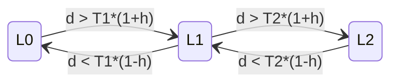
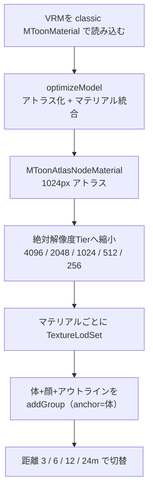

# three-texture-lod

three.js 向けの距離ベース・テクスチャ LOD ライブラリ。カメラ距離に応じて
マテリアルバリアントを差し替え、遠くのオブジェクトほど低解像度テクスチャで描画する。
`WebGPURenderer`（WebGPU / WebGL2 フォールバック）で動作する。
複数メッシュ・複数マテリアルを同じ距離で切り替える `addGroup` と、
VRMアバターを実行時に最適化してLOD化するデモを含む。

## 方式

解像度の異なる別テクスチャをレベルごとに持ち、カメラ距離に応じて
事前生成したマテリアルバリアントを `mesh.material` へ代入して切り替える。
テクスチャ差し替えではなくマテリアル差し替えにする理由は、
描画パイプライン（シェーダ）をレベル間で共有し、切替時の再コンパイルをなくすためである。

### パイプライン共有の実測結果

デモ（60板・3レベル）で `renderer._pipelines` を観測した実測値（webgpu / webgl 共通）。
基準値は LOD無効の新規ページ（`?lod=0`、ベースマテリアルのみ描画）で数フレーム後に取得し、
有効化後・近↔遠往復後と比較する（caches はページ内でリセットできないため別ページで測る）。

| 時点 | `caches` | `programs.fragment` |
| --- | --- | --- |
| LOD無効時の基準値 | 2 | 2 |
| LOD有効化後（全板に再付与） | 2 | 2 |
| 近↔遠往復後 | 2 | 2 |

切替前後で増加なし。レベルごとにマテリアル実体は別だが、
テクスチャ解像度の違いはパイプラインを分けないことが確認できる。

## 使い方

```ts
import { WebGPURenderer } from 'three/webgpu';
import { MeshStandardMaterial } from 'three/webgpu';
import { createTextureLodSet, TextureLodManager } from 'three-texture-lod';

const renderer = new WebGPURenderer({ canvas, antialias: true });
await renderer.init();

// 解像度の異なる3枚を用意する（色空間・ラップ等の設定は全レベルで統一）。
const base = new MeshStandardMaterial({ map: textureHi, roughness: 0.85 });

const set = createTextureLodSet({
  material: base,
  levels: [
    { distance: 0, textures: { map: textureHi } },
    { distance: 10, textures: { map: textureMid } },
    { distance: 25, textures: { map: textureLow } },
  ],
  hysteresis: 0.1,
});

const manager = new TextureLodManager({ distanceMode: 'surface', residency: 'evict' });
manager.add(mesh, set);

// 1つの距離で複数メッシュ・複数マテリアルを連動させる場合（VRMの体+顔+アウトラインなど）。
// 全セットの距離境界とヒステリシスは一致させること。remove はグループ全体を解除する。
manager.addGroup(
  [
    { mesh: bodyMesh, set: bodySet },
    { mesh: faceMesh, set: faceSet },
  ],
  { anchor: bodyMesh },
);

// 毎フレーム、描画前に更新する。
manager.update(camera);
renderer.render(scene, camera);
```

`three-texture-lod` は npm 公開していない private パッケージのため、
利用側では workspace 参照または `file:` 依存で `dist/lib` を参照する。
配布物は `pnpm build:lib` で `dist/lib/` に生成する（JS + 型宣言）。

```sh
pnpm build:lib   # dist/lib/three-texture-lod.js + dist/lib/index.d.ts を生成
pnpm build:all   # デモ（dist/demo/）とライブラリ（dist/lib/）を両方生成し、共存させる
```

## API要約

- `createTextureLodSet(options)` / `TextureLodSet` — 1メッシュ分のLOD定義。
  レベルごとにバリアントマテリアルを事前生成する。`variant(level)` で取得、
  `canonicalLevel(level)` で属する共有グループの先頭レベルを取得、
  `syncFromBase()` で後付けの材質変更を全バリアントへ反映、`dispose()` で破棄。
  同一内容のレベルは同じマテリアル実体を共有する（`variant(0) === variant(2)` などがあり得る。
  そのため `createVariant` フックはグループ先頭レベルで1回だけ呼ばれる。
  スロット名はマテリアル型の `Texture | null` プロパティから導出するため、
  MToon の `shadeMultiplyTexture` なども `as` なしで指定できる。
- `TextureLodManager` — 複数メッシュのレベル判定と常駐管理。
  `add(mesh, set)` / `addGroup(bindings, { anchor })` / `remove(mesh)` /
  `update(camera)` / `levelOf(mesh)` / `stats()` / `dispose()` /
  `setThresholdScale(scale)` / `setMaxResidentBytes(bytes | null)` /
  `setFinestLevel(level)`。
  `addGroup` は複数メッシュを1つの距離で連動させ、統計もグループ単位になる。
  `setThresholdScale` は固定倍率の更新（自動スケール有効時は `Error`）。
  `setMaxResidentBytes` は予算の再設定（作り直し不要、`keep-all` で非 `null` は `Error`）。
  `setFinestLevel` は手動のTier上限（`?top` 相当。非整数・負の値は `RangeError`。最大レベルを超える値は受け付け、そのセットの最粗でクランプする）。
  `stats()` には `thresholdScale`（現在の倍率）/ `finestLevel`（現在のTier上限。手動 `?top` と予算適応（2軸）のcapの厳しい方）/
  `requiredBytes`（update直後の現用＋最粗の必要量。`overBudgetBytes` は resident 基準の超過量で別物）/
  `pinnedBytes`（最粗レベルの常駐量。下限状態では `requiredBytes === pinnedBytes` になる）/
  `scaleLowerCount` / `scaleRaiseCount` / `levelCapLowerCount` / `levelCapRaiseCount` が出る。
- `selectLevel(previous, distance, thresholds, hysteresis)` — ヒステリシス付き判定の純粋関数。
- `computeLodDistance(object, camera, mode)` — 中心距離（`center`）または
  バウンディング球表面からの距離（`surface`、0クランプ）を返す。

## ヒステリシス

境界を `T[i]`（`T[0] = 0`、狭義単調増加）、幅を `h`（`0 <= h < 1`）とする。
初回は `d >= T[i]` を満たす最大の `i` を選び、以降はバンド端を越えた分だけ移動する。

- 上方向: `d > T[level+1] * (1 + h)` の間 `level++`
- 下方向: `d < T[level] * (1 - h)` の間 `level--`



バンドが重ならない条件（`T[i]*(1+h) < T[i+1]*(1-h)`）はセット生成時に検証し、
重なる定義は `Error` で拒否する。

### 設定値の意味

| 設定 | 既定 | 意味 |
| --- | --- | --- |
| `hysteresis` | `0.1` | 境界付近のちらつき抑止幅。`0` で単調なしきい値判定になる |
| `distanceMode` | `'surface'` | `'surface'` は球半径を差し引く。大きな板が目の前にあっても粗LODに落ちない |
| `residency` | `'evict'` | `'evict'` は未使用テクスチャを破棄、`'keep-all'` は全保持 |
| `evictDelayMs` | `5000` | `evict` 時の最終使用からの猶予。`0` で即時破棄。`Infinity` で時間破棄を止め容量のみのキャッシュにできる |
| `maxResidentBytes` | 上限なし | 常駐推定バイト数の上限。超過時は未参照・非ピンを古い順に破棄。`keep-all` と併用不可。推定値で判定し、`update()` 内でのみ適用 |
| `thresholdScale` | `1` | 固定の距離しきい値倍率。有限かつ `> 0`。`adaptiveThresholdScale` との同時指定は不可 |
| `adaptiveThresholdScale` | `false` | `true`（または調整値 object）で予算適応（2軸）の距離スケールを有効化。`keep-all`・`thresholdScale` との併用不可。`maxResidentBytes` 未設定時は引き上げだけを行う |
| `finestLevel` | `0` | 手動のTier上限（レベル番号。0が最細）。`?top`・`setFinestLevel` の実体。adaptive の下限になり、厳しい方が効く |
| `now` | `performance.now` | 時刻源。テストで時間を操作するための注入点 |

### 予算適応の補足

- 調整値 object の `levelCap` は既定 `true`。`false` にするとcap軸を無効化し、従来のスケールのみで適応する。`finestLevel` は adaptive の下限として常に効き、手動上限より粗くはならない。
- cap で下げた後にスケールが戻る場合も `scaleRaiseCount` が増えることがある（2軸が連動して予測し直すため）。

### 単位の注記

- 容量はMiB（`stats()` のバイト値を1024²で割った値）で記載する。URLパラメータ（`?budget`・`?atlas`）とGUI表示はMB表記のまま。

### evict の補足

- 最粗レベル（L4、256px）は常駐（pin）し、破棄対象にならない。遠景でも描画が欠けない。
- `texture.dispose()` は GPU 側のリソースだけを解放し、CPU 側の `image` は残る。
  近景復帰時は再アップロードが走るため、大きなテクスチャではヒッチし得る。
- LOD管理外のメッシュやベースマテリアルが同じ `Texture` を使っている場合、
  `evict` はそのテクスチャも破棄対象にし得る。管理外の利用があるなら `keep-all` を推奨する。
- `maxResidentBytes` を設定すると、常駐推定値が上限を超えた分だけ、
  未参照（`refs === 0`）かつ非ピン（`pins === 0`）のテクスチャを
  最終使用の古い順（同時刻なら推定バイトの大きい順）に、猶予を待たず破棄する。
  現用中と最粗レベルは守られるため、上限まで下げられない場合は超過を許容する
  （`stats().overBudgetBytes` で確認する）。破棄の累計は `stats().evictCount` に出る。
- `adaptiveThresholdScale: true`（または調整値 object）を指定すると、
  予算に収まる最も細かい組み合わせを予測常駐量（`stats().requiredBytes`、現用＋最粗）から2軸で選ぶ。
  判定距離を `d/scale` に読み替え、しきい値の `scale` 倍と等価にする（スケール軸）。
  残りはTier上限 `finestLevel` の引き上げで粗くする（cap軸。`levelCap: false` で無効化可）。
  下げは即時・複数段、上げは `predict(1段上) <= 0.9 * budget` のときだけ1段上げる
  （1段/秒・引き下げ後の冷却3秒・余裕 `0.9`。cap上げも1段/秒＋冷却3秒）。
  `need`（`requiredBytes`、現用＋最粗の必要量）と
  `over`（`residentBytes` 基準の上限超過量）は別物である。
  上げ下げの回数は `scaleLowerCount` / `scaleRaiseCount` / `levelCapLowerCount` / `levelCapRaiseCount` に出る。
  `need` が予算を上回ったまま `requiredBytes === pinnedBytes` に張り付くと FLOOR（下限）で、超過が残る。
- 予算が最粗レベルの合計より小さい場合や、近接個体で下げても足りない場合は
  下限（スケール既定 `0.05`・cap最粗）に張り付き、超過が残る（保証ではない）。
  デモの起動オプション（`?adaptive=0` / `?scale`）はデモ節を参照。
  固定・自動の同時指定と `keep-all` との併用は `Error` である。
- `evictDelayMs: Infinity` と `maxResidentBytes` の併用で、時間では破棄せず容量だけで破棄するキャッシュになる。
- 非表示（`visible === false`）のグループは判定を飛ばして参照を保持するため、
  そのテクスチャは上限破棄でも解放できない。隠したまま上限を締めると超過が残る。
- 事前に全レベルをアップロードしておくウォームアップAPIは用意していない。

### 距離の測り方

- カメラのワールド位置だけを使い、FOV・ズーム・正射影は考慮しない。
- 基準はバウンディング球。`center` は球中心までの距離、`surface` は球面までの距離（0クランプ）。

## VRMデモ

`vrm.html` は、複数のVRMを読み込み、[avatar-optimizer](https://github.com/WebXR-JP/avatar-optimizer) で
アトラス化・マテリアル統合したうえで、アバター単位でテクスチャLODを適用する実践的なシーン。
体・顔・アウトラインが複数メッシュ・複数マテリアルに分かれても、1体を1グループとして同じレベルで切り替える。



### 起動

```sh
pnpm install
pnpm models:fetch   # AvatarSample_A/B/C を public/models/ へ取得（約42MB）
pnpm dev
# http://localhost:5173/vrm.html
```

モデルはリポジトリに含めない。`public/models/` に自分の `.vrm` を置くか、
デモ画面へドラッグ&ドロップしてもよい（ソースは最大4体、複製込みの総数は最大100体）。
サンプルのライセンスは [public/models/README.md](public/models/README.md) を参照。

URLパラメータ: `?models=A,B,C`（読み込むモデル。ソースは最大4）、`?avatars=4`（総体数、既定4、1〜100）、`?backend=webgl`、
`?lod=0`（LOD無効）、`?top=1024`（Tier上限。これより細かくしない手動下限。4096/2048/1024/512/256。
非Tier値はその値以下で最大のTierに丸める（例 `?top=1500` → 1024・L2）。`?top=0` 以下は256（L4）に丸め、非数値は無視。`?scale`・adaptive と併用可（厳しい方が効く）。
`?lod=0`・手動レベル固定では無効）、
`?wander=0`（徘徊無効。全員を配置位置に固定）、`?h=0.15`、`?atlas=256..4096`（既定1024）、`?auto=0`（自動カメラ停止）、
`?residency=keep-all`、`?evictDelay=1000`、`?budget=32`（常駐上限MB、`0` で無効、既定 `0`、`0〜4096`。
GUIスライダーも `0〜4096`）、
`?adaptive=0`（予算適応（2軸）の距離しきい値スケールを無効化。既定で有効。予算0では実質無効だが、
manager には adaptive を渡すため、`setMaxResidentBytes` で後から予算を設定できる。作り直しは不要）、
`?scale=0.5`（固定の距離しきい値倍率、`0.05〜4`。範囲外はクランプ、非数値は無視して adaptive。指定時は adaptive より優先）、
`?hud=0`（HUDを折りたたんで起動。`?hud=1` で展開。一時的な上書きで localStorage には保存されない。既定は展開）。

### 方式

- 読み込みは **classic MToonMaterial**。three r187 では three-vrm の `MToonNodeMaterial` が
  `transformedNormalView` を要求してバンドルできないため、最適化後の描画だけを
  `@webxr-jp/mtoon-atlas/nodes` の `MToonAtlasNodeMaterial`（TSL）へ置き換える。
  classic のマテリアルは最適化で全て置き換わるので、WebGPURenderer では描画されない。
- アトラスは `map` / `shadeMultiplyTexture` / `normalMap` / `emissiveMap` などの
  使用スロットだけを実サイズで作り、未使用スロットは 8px に落とす。
- 各スロットを絶対解像度Tier（4096 / 2048 / 1024 / 512 / 256）の5レベルに縮小する。
  Tier `T` のテクスチャは長辺を `min(T, そのテクスチャの最大)` にし、
  整数分割 `divisor = max(1, ceil(maxDim / T))` で切り詰める（非2冪でもTier以下に収まる）。
  ソースがTierを持たない場合は最大解像度にクランプする（同じTextureを複数レベルで共有してよい）。
  色は sRGB をリニアへ戻して平均し、RGB はアルファで重み付け、法線は再正規化する。
  全レベルにミップマップを付け、切替時のちらつきを抑える。
- 距離境界は `surface` で **3 / 6 / 12 / 24m**、`h=0.15`。初期構図（`?auto=0`）では4体を
  2.7 / 5.3 / 10.7 / 16.3m に置き、L0 / L1 / L2 / L3 が同時に確認できる（L4は24m以遠）。
  Tier値は `LOD_TIERS = [4096, 2048, 1024, 512, 256]` の絶対解像度で、level 0 が最細。
  `?atlas=256` では全Tierが同一テクスチャになり、LODは実質無効になる。
- 1体につき最大4マテリアル（opaque / alphaTest / transparent + アウトライン）が
  同じアトラステクスチャを共有する。`addGroup` で全メッシュを1レベルに同期させることで、
  顔だけ先に粗くなる逆転と、参照カウントのずれを防ぐ。
- HUDの `models` 行は `sources 3 / avatars 4 (clones 1)` のように、
  最適化したソース数と、複製込みの総体数を分けて出す。
  最適化・メッシュ・マテリアルの集計はソースのみで、複製のゼロ値は足さない。
  `meshes` 行の `(rendered N)` は全ハンドルのメッシュ合計である。
  HUDはヘッダーのクリック / `H` キー / `?hud=0` で折りたためる。ヘッダー・`H` キーでの切替は localStorage に保存するが、
  `?hud` は一時的な上書きで保存されない。

### 最適化済みモデルの複製で体数を増やす

- `?avatars=N` で総体数を指定する（1〜100、既定4）。
  読み込むソースは `?models` の先頭から `min(4, avatars)` 体までで、足りない分は
  最適化済みモデル（テンプレート）の複製で補う。
  既定は `?models=A,B,C` + `?avatars=4`（3ソース + Aの複製1体）。
  `?models=A,B,C,A&avatars=4` なら従来どおり4ソースになる。
- GUIの「体数」スライダー（1〜100）で一括増減できる。変更は配置とトースト1回で済ませ、
  `guiState.avatarCount` は変更時にだけ同期する（毎フレームは書かない）。
  「複製を追加」/「複製を削除」ボタンも残し、押下後は体数を同期する。
  追加はインスタンスが最も少ないテンプレートを複製し、削除は最後の複製を外す。
- GUIの「うろちょろ」チェックボックス（`?wander=0` で起動時OFF、既定ON）で徘徊を切り替える。
  OFFでは全員が配置位置（home）に固定され、正面を向く（ソースの SpringBone もリセットする）。
  ONに戻すと、待機を短縮してその場から動き出す。
  瞬間移動しないのは home がずれた場合（末尾以外の複製削除で後続の home が前に詰まるなど）で、
  そのときはその場から配置円内への歩行を始める。
- GUIの「メモリ上限(MB)」スライダー（`0` で無効、既定 `0`、範囲 `0〜4096`）で `maxResidentBytes` を変えられる。
  変更は `setMaxResidentBytes` で反映し、作り直しはしない（`adaptive` の有効/無効が切り替わるときだけ作り直す）。
  `keep-all` 選択中と LOD無効中は無効化される。上限が効いている間、HUD の `VRAM` 行に
  `上限 / 超過 / 破棄回数` が出る（`keep-all` では `budget off (keep-all)` と出る）。
  予算適応（2軸）が有効なときは `scale`（現在の距離しきい値倍率）・`top`（現在のTier上限。`(manual)`/`(auto)` 付き）・
  `need`（必要量＝現用＋最粗）も出て、
  `need` が予算を上回ったまま下限（`requiredBytes === pinnedBytes`）に張り付くと `FLOOR` が付く。
  カウンタは `scaleLowerCount` / `scaleRaiseCount` / `levelCapLowerCount` / `levelCapRaiseCount` の4つで、
  HUD の `switch` 行とは別に manager stats で確認する。`?adaptive=0` では従来の表示のまま。
  近接個体で下げても足りない場合も同様に下限に張り付く（保証ではない）。
- GUIの「自動スケール」チェックボックス（`?adaptive=0` で起動時OFF、既定で有効。予算0では実質無効）で予算適応（2軸）を切り替える。
  変更時はマネージャを作り直す。`keep-all` 選択中と LOD無効中は無効化される。
  「しきい値倍率」は読み取り専用の表示で、`?scale` 固定時は `fixed 0.50` のように出し、
  適応時は現在の `scale` を250msごとに反映し、無効条件（keep-all / LOD無効 / 手動固定）では `off` を出す。
  手動の倍率変更は `?scale=0.05..4` で行う（スライダーはない。範囲外はクランプ、非数値は無視）。
- 複製は最適化を再実行せず、アトラス・テクスチャ・マテリアル・LODセットを
  テンプレートと共有する。メッシュと束縛だけを複製ごとに持つため、
  複製を増やしても `Too many active WebGL contexts` 警告は出ない。
- `?avatars` を省略した場合は4。`?models=A,B` のようにソースが4未満でも、
  複製で4体まで補う。`?avatars=1` にすると最初のソース1体だけになる。
- 5体以上では3Dラベルは先頭4体のみ表示し、残りはHUDの行で確認する。
  HUDのアバター行は先頭12体まで出し、それ以上は `… +N more` にまとめる。
  名前の桁揃えは `padEnd(6)` である。
- 100体では先頭4体が L0/L1/L2/L3、残りはほぼ遠景のL3/L4になる（負荷・共有の確認向け）。
  配置は先頭4体の固定位置を保ち、5体目以降は中央の視線レーン（`|x| < 3.0` かつ `z > -12`）を
  空けたグリッド（間隔 2.4、最前列 z=-1.0、中央から左右へ）に置く。
  最遠は z=-20.2 付近で、カメラ（z=7.5）から約28m、fog（24〜66）が薄くかかる距離に収まる。
- ソース上限（最大4）はデモ側の仕様（`?models` の最大4件）であり、
  最適化のコンテキスト上限ではない。avatar-optimizer 0.6.0 はアトラス合成用に
  共有のオフスクリーン `WebGLRenderer` を使い回すため、同時コンテキスト数は
  ソース数・スロット数に比例しない。複製はこの上限と無関係である。
- 複製は最適化済みシーンの bone を clone するため、VRM の Humanoid / SpringBone /
  ExpressionManager は持たない。rest pose と頭ボーンの揺らしのみで、髪の物理・
  瞬き・表情は静的になる。フル動作が必要なモデルはソースとして読み込む（上限4）。
- 徘徊は足の歩行アニメではなく、旋回・加減速・上下動で表現する。
  目的地は配置位置を中心とする半径 0.7m の円から一様に選び、向きを合わせてから
  加減速して進む。待機（0.5〜3.0秒）→ 70%で歩行・30%でその場転回を繰り返す。
  衝突判定はしない。隣とは配置間隔（2.4m）から徘徊半径を引いた分だけ離れる
  （セル半径での分離）。上下動は歩行中だけ振幅 0.02m になる。

### 実測（WebGPU / WebGL2）

1024px アトラスの実測（smoke第七回・両backend `ok:true`、WebGPUを基準に記載）:

| 項目 | 値 |
| --- | --- |
| 最適化前 → 後（1体） | mesh 90 → 12、material 26 → 4 |
| アトラス使用スロット | map / shadeMultiplyTexture / normalMap / emissiveMap |
| map実幅（5レベル） | [1024, 1024, 1024, 512, 256]（L0-L2は同一Textureを共有） |
| normalMap実幅（半分開始のため） | [512, 512, 512, 512, 256]（実測。L0-L3共有） |
| アトラス `atlasBytes`（1体） | 約13.3MiB（13982037B） |
| 全レベル常駐 `residentBytes`（`keep-all` でL0→L4到達後） | 約17.3MiB（18175317B。atlasの約1.30倍） |
| 1体スモーク: evict 近景(L0)→遠景(L3)→復帰(L0)→最遠(L4) | 14.7MiB → 6.7MiB → 14.7MiB → 1.3MiB（半減以上・evictCount増加で解放を確認。`textureCount` はL0→L3はテクスチャ枚数が同じため21のまま（実測）だが、L4では最粗pinのみになり21→17に厳密減少） |
| 復帰時の中央領域輝度比 | WebGPU 38.87→38.63（比0.994）、WebGL 38.20→38.43（比1.006）。いずれも `\|ratio-1\| < 0.1` |
| パイプライン（1体、L0↔L4を複数往復） | caches 12 → 12、fragment 12 → 12 |
| ヒステリシス（1体、T=[0,3,6,12,24]、h=0.15） | 16点系列＋上側バンド保持4点が一致（L4遷移は28.0m、保持は25.5mで確認）、バンド内6往復で切替0、h=0 で10回切替。メッシュ間は共有のためcanonical一致＋適用マテリアル一致で確認 |
| 4ソース（A,B,C,A・L0/L1/L2/L3が1体ずつ） | 常駐 50.7MiB（full 53.3MiBの0.95倍。L0-L2が同一1024テクスチャを共有するため半分未満にはならない） |
| 複製時（ソース1 + 複製3、L0/L1/L2/L3が1体ずつ） | 最適化1回、常駐 17.3MiB（ソース1体分13.3MiBの約1.30倍） |
| 既定（3ソース + 複製1） | mesh 319 → 36（rendered 48）、material 272 → 12、atlas 40.0MiB、常駐 46.7MiB |
| 上限キャッシュ（3ソース + 複製1、`&adaptive=0`、`?evictDelay=10000` で予算なし起動。WebGPU/WebGLとも同値） | 全レベル常駐 total が現用＋最粗 required の1.05倍超であることを確認し、required < budget < total の中間値（動的決定。実測では約50MB台）を設定。段2だけが掃引して resident≤budget・over 0・evict増加・レベル不変（段2の証拠）。8MBに締めると resident===required・over>0・レベル [0,1,2,3] 不変。350ms間隔2回で evict 増加なし。解除で上限なし・over 0 |
| 予算適応（2軸） `?budget=32`（3ソース + 複製1、smokeでWebGPU/WebGLとも同値） | 起動直後に scale 0.42 まで下げ（lower 1、capは0のまま）required 22.7MiB ≤ 32MB・over 0、levelCounts [0,0,1,1,2]（全員L4でない）。2MB締めで scale 0.05・finest 4 まで下げ（lower 2・capLower 1）required 4.0MiB（= pinned）・over 2.0MiBでFLOOR・全員L4を許容。解除で scale 1・finest 0 に復帰（raise +18・capRaise +2、約23〜25秒）。復帰後に5秒無変化で静定。再適用（0→8MB）は required 4.0MiB・over 0 で収束し、マネージャ世代番号が不変（作り直しなしの証拠） |
| Tier上限 `?atlas=4096&top=1024`（1ソース、WebGPUのみ） | `topLevel=2`・`topResolution=1024`・`finestLevel=2`、選択L2。map幅 [4096,2048,1024,512,256]、normal幅 [2048,2048,1024,512,256]、選択レベルmap幅1024、console 0 |
| 予算cap `?atlas=4096&budget=64`（1ソース・近距離、WebGPUのみ） | `finestLevel=2`・`scale=1`・required 22.7MiB ≤ 64MB・over 0・`levelCapLowerCount=1`、選択L2のmap幅1024（≤2048）。解除で最大2秒で `finestLevel=0` に戻る |
| Tier上限の軽量検査 `?atlas=1024&top=1024`（1ソース、WebGL） | `backend=webgl`・`topLevel=2`・`topResolution=1024`・`finestLevel=2`、選択L2、console 0。`&backend=webgl` 付きでWebGPU起動を避ける。ready までの時間も記録する |
| 4096・1ソース（WebGPU） | `atlasBytes` 約213.3MiB（223697237Bを維持）。L0常駐 214.7MiB、L1 86.7MiB、L2 22.7MiB、L3 6.7MiB、L4 1.3MiB。全レベル常駐（`keep-all`）約283.9MiB（297796584B。atlasの約1.33倍） |
| 4096・3ソース・50体・予算256MB・徘徊ON（WebGPU、Xvfb。`artifacts/vrm/tiers-4096-50-256.png`） | `finestLevel=1`・`scale=1.0` で安定、`requiredBytes` 254.7MiB・`residentBytes` 254.7MiB・`over` 0、`levelCapLower 1 / raise 0`、レベル [0,2,11,37,0]、frame p50 916.6ms / max 933.3ms（SwiftShader。実行ごとに振れる。HEAD 4段でも同条件 916.6ms（同値。実行ごとの振れの範囲内））。予算内に収めるため cap 軸を選んだ結果、4段時の scale 0.84 / required 156.7MiB より高解像度・高常駐。cap=1・scale=1 を選び、L1=2048（normal は案Yで2048）とL2 11体＋L4 pin を保持したため |
| 同条件・予算なし | 推定（再計測なし）。過去値は resident 316.7MiB |
| 同条件・`adaptive=0&budget=256` | 推定（再計測なし）。過去値は over 60.7MiB のまま |
| `?scale=0.5`（固定倍率） | 推定（再計測なし）。過去値は `lower`/`raise` 0、予算超過分は evict のみで処理 |
| 100体（3ソース + 複製97、Xvfb） | rendered 1200 mesh、常駐 52.0MiB（full 40.0MiBの1.30倍。HEAD 4段時の19.8MiBの2.63倍。L0-L2 が同一1024テクスチャを共有する絶対Tier化の設計変更によるもので、`?top` や予算で抑えられる）、レベル [1,1,11,61,26]（L3+L4=87）、ringCount 100、警告0。WebGL（`--use-angle=vulkan`・実ハードウェア NVIDIA RTX 3090）・静止時 frame 35.0ms / upd 1.1ms / calls 1046 / pipelines 22、徘徊時 frame 36.8ms / upd 1.1ms / calls 1048。WebGPU（`navigator.gpu.requestAdapter().info` が SwiftShader の環境）・静止時 frame 1814.8ms / upd 1.4ms / calls 1046（HEAD 4段でも同条件 1805.7ms で、5段化の差は +0.5%。update/calls は不変）。起動（読込開始〜ready）約3.3〜3.6秒、`setAvatarCount(4)` 4〜5ms・`(100)` 44〜87ms |

### 注意

- **ソースは最大4体、複製込みの総数は最大100体**。構造面では、avatar-optimizer 0.6.0 は
  アトラス合成用のオフスクリーン `WebGLRenderer` を1つ共有するため、
  同時WebGLコンテキスト数はソース数・スロット数に比例しない
  （0.5.0 以前は合成のたびに一時レンダラーを生成・破棄していた）。
  実測面では、WebGL の4ソース最適化は smoke で2回連続、警告・Device Lost なしを確認
  （2026-11-25、Xvfb）。
  複製は最適化を再実行しないため、この上限と無関係である。
- `?atlas=2048` / `?atlas=4096` はVRAM・起動時間・GCが主たる制約になる。
  合成時の一時 `WebGLRenderTarget` が `map` / `shadeMultiplyTexture` で2048は1枚約16MB、
  4096は1枚約64MB（1024なら約4MB）かかり、LOD全レベルの合計は1024の面積比で約4倍（2048）/
  約16倍（4096）になる。4096・1ソースの計測では、`atlasBytes` 約223.7MB（213.3MiBを維持）、
  全レベル常駐（`keep-all` でL0→L4到達後）約297.8MB（283.9MiB、atlasの約1.33倍。Xvfb、WebGPU）。
  `atlasBytes` も `residentBytes` も既にミップマップ係数 4/3 込みの値であり、
  `residentBytes` が大きいのは共有されていない粗いレベルが常駐する分である。
  L0-L2は同一Textureを共有するため、1024では3レベル分の節約にはならない（常駐は増える）。
  3ソース1024の実測約40.0MiBを基準に、4096・3ソースは full 約640MiB級・resident も同規模の推定になる（再計測なし）。
  L0 アトラスと縮小テクスチャ L1〜L4 は、いずれも `DataTexture` の `Uint8Array` を保持し続けるため、VRAM と同程度
  （4096・1ソースで約210MiB規模）のJSヒープも消費する。3ソースではVRAMと合わせてGB級になり、
  タブがメモリ不足で落ちるリスクがある。
  4096はダウンスケール処理（全スロット×4段階）が1024の約16倍の画素演算になり、起動に時間がかかる（推定。詳細は再計測なし）。
  4096を使う場合はソース1体を推奨し、3ソースはVRAM・起動時間・GCで現実的でない可能性が高い。
  50体でも resident はソース数分しか増えない。3ソース・4096・予算256MBなら
  adaptive により finest=1・scale=1.0 で安定する（実測。50体・徘徊ONで required 254.7MiB）。
  コンテキスト数は0.6.0の共有レンダラーによりソース数に比例しないが、VRAMは比例する。
  2048を使う場合はソース2〜3体を推奨する。
- `?atlas=256` は全Tier（4096/2048/1024/512/256）が同一テクスチャになり、LODは実質無効になる。
  デバッグ用以外では使わないこと。
- `matcap` はUV非依存なのでLOD対象外（元テクスチャのまま）。
- 最粗256px（1024時も4096時も。128pxは廃止）ではアトラスのパディングがないため、隣接するUV島の色が滲む可能性がある。
  髪やまつげのアルファテストは最粗レベルで目視確認すること。
- `materialColorBind` / `textureTransformBind` は最適化前のマテリアルを参照するため、
  最適化後は効かない（LODとは別の既存制約）。
- アバターの `SkinnedMesh.boundingSphere` はスキニング後の頂点から計算され、
  実体より大きくずれる（実測 r=2.36、geometry は 0.85）。デモでは距離とカリングを
  bind pose の geometry 球に固定している。
- サンプルモデルは CC0 ではない。利用条件は [public/models/README.md](public/models/README.md)。

## 制限

- 判定はオブジェクト単位。`InstancedMesh` のインスタンス単位LODには非対応
  （メッシュ全体の球で1レベルに決まる）。複数メッシュをまとめる場合は `addGroup` を使う。
- LOD対象スロットはマテリアル型の `Texture | null` プロパティから導出する。
  `colorNode` 等で独自に `texture()` を組んでいるマテリアルは自動LOD化できないため、
  `createVariant` フックでレベルごとのノードを組み直す。
- 圧縮テクスチャの可否はバックエンド依存。レベル間で色空間・フィルタ等の
  設定がずれると警告（`console.warn`）を出す。解像度以外の見え方は統一すること。
- `residentBytes` は RGBA8・ミップマップ係数 4/3 の推定値であり実測ではない。
- デモの `_pipelines` 観測はデバッグ用の内部アクセスであり、公開APIではない。
  three の更新で構造が変わる可能性がある。

### 互換性の注意

- 同一内容のレベルはマテリアル実体を共有するため、`createVariant` フックは共有グループの先頭レベルで1回だけ呼ばれる（全レベルでは呼ばれない）。従来はレベルごとに呼ばれていたため、呼び出し回数を前提にしたコードは見直すこと。
- 同一内容レベルの `variant(i)` は同じマテリアル実体を返すため、レベル別にマテリアルを書き換えると共有先にも及ぶ。共有バリアントの名前は `#lod0-2` 形式になる。
- `TextureLodStats` に必須フィールドが4つ（`finestLevel` / `pinnedBytes` / `levelCapLowerCount` / `levelCapRaiseCount`）増えるため、stats をモックする利用側は型更新が必要。
- 調整値 object の `levelCap` は既定 `true`。明示的に `false` を渡さない限り、予算適応はスケール軸に加えてTier上限（cap軸）でも粗くする。従来のスケールのみの挙動に戻すには `levelCap: false` を指定する。

## デモ

```sh
pnpm dev            # 動作確認（ブラウザで開く）
pnpm build          # デモアプリを dist/demo/ に出力（dist/lib は残る）
pnpm build:lib      # ライブラリを dist/lib/ に出力（デモは残る）
pnpm build:all      # デモとライブラリの両方を生成し、dist/ 配下に共存させる
pnpm models:fetch   # VRMデモ用のサンプルモデルを public/models/ へ取得
```

- 板ポリのLODデモ: `http://localhost:5173/index.html`
- VRMデモ: `http://localhost:5173/vrm.html`（`pnpm models:fetch` が必要）

板ポリのデモでは、右上の lil-gui と左上の HUD で操作・観測する。

| 操作 | 内容 |
| --- | --- |
| `autoMove` / `speed` | カメラの自動往復（z: 6 → -70 → 6）と速度 |
| `hysteresis` / `residency` / `evictDelayMs` / `maxResidentBytes` / `distanceMode` | 設定を丸ごと再構築（カウンタはリセット） |
| `LOD有効` | 全meshの登録／解除（解除時はベースマテリアルに戻る） |
| `近距離へ` / `遠距離へ` | カメラを z=0 / z=30 へ即時移動 |
| `h=0で往復テスト` | ヒステリシスなしで境界 T=10 / 25 を往復 |

URLパラメータ: `?backend=webgl`（WebGL強制）、`?auto=0`（自動移動OFF）、
`?h=0.2`（作成時h）、`?residency=keep-all`、`?z=-30`（初期カメラz）、
`?lod=0`（LOD無効で起動。ベースマテリアルのみ描画）。

## スモーク

```sh
pnpm smoke          # build済み前提。preview起動→検証→kill
```

Playwright（`playwright-core`）が headed Chrome を起動し、
webgpu / webgl の両バックエンドで以下を検証する。
待機は `stats().frame` の進行＋条件ポーリングで行い、固定sleepに依存しない。

1. `__lodDemo.ready` の待機、pageerror / console.error の収集
2. パイプライン基準値を LOD無効の新規ページ（`?lod=0`）で取得し、
   有効化後・近↔遠往復後も `caches` / `fragment` が増えないこと
3. 近距離で `L0` と `L2` が混在し、遠距離で全板が `L2` になること（stats整合つき）
4. ヒステリシス厳密検証（h=0.2, center）:
   `5→L0`, `12.1→L1`, `9→L1`, `7.9→L0`, `9→L0`, `11.9→L0`, `12.1→L1`
   （同じレベルが続くケースもフレームを進めてから読む）
5. バンド内往復（`9.5↔10.5` を10往復）で切替0、対照の h=0 はプローブ単体の系列
   `9.9→L0`, `10.1→L1`, `9.9→L0`, `10.1→L1` で追従すること（`switchCount` は参考記録のみ）
6. テレポート: L0から `setProbeDistance(40)` 1回で frame+2 以内に L2（frame差分を記録）
7. `evict` 即時破棄で `residentBytes` が半分未満に減り、
   近景の中央領域の画素輝度が背景より十分明るい（`> 30`）こと、
   復帰時は `|recovered / near - 1| < 0.1` の両側判定を満たすこと（pngjsで実描画をassert）。
   遠方の輝度は記録のみ
8. `keep-all` では遠ざけても `residentBytes` が減らないこと
9. 近距離・遠距離・evict前後のスクリーンショット保存（`artifacts/`）

結果は JSON で標準出力し、失敗時は exit 1。出力にはパイプライン数、輝度、
`residentBytes`、レベル分布、h=0 / h=0.2 の切替回数を含める。
表示できない環境では
`xvfb-run -a pnpm smoke` のように Xvfb 経由で実行する。
Chrome のパスは `CHROME_PATH` 環境変数で上書きできる
（既定: `/run/current-system/sw/bin/google-chrome`）。

### VRMデモのスモーク

```sh
pnpm models:fetch   # 初回のみ
pnpm build          # public/models を dist/demo へコピー
pnpm smoke:vrm      # WebGPU / WebGL2 の両方
```

1体（`?models=A&avatars=1`）を読み込み、最適化前後のメッシュ・マテリアル数、LODセット数、
アトラス解像度・使用スロット、バリアントの実テクスチャ幅（[1024,1024,1024,512,256]）を確認する。さらに
ヒステリシス16点の系列（T=[0,3,6,12,24]、L4遷移は28.0m）とメッシュ間の同期（共有のためcanonical一致＋適用マテリアル一致）、バンド内往復で切替0、上側バンド保持4点、h=0の境界往復、forceLevel=3/4、
L0↔L4 を繰り返した後のパイプライン非増加、
`evict` の常駐減（20mでL3・30mでL4。解放はevictCount増加＋resident半減で確認し、30mでは実GPUテクスチャ数も21→17に厳密減少）と画素輝度の復帰、
`keep-all` の非減、コンソール/GPU警告0を検証する。
続けて既定（`?auto=0`、3ソース + 複製1）を読み込み、`sourceCount=3` / `cloneCount=1`、
初期レベル `[0,1,2,3]`、最適化回数3、複製の `optimizeMs=0`、メッシュ内レベル同期、
読み込み失敗0、コンソール/GPU警告0を検証する。さらに複製（`?models=A&avatars=4&auto=0`）で
`sourceCount=1` / `cloneCount=3`、最適化回数1、常駐がソース1体分の1.4倍未満、
raw 頭ボーンの揺れ（SkinnedMesh の skeleton 所属と角度差）、追加/削除、h変更後の再バインドを検証する。
4ソース（`?models=A,B,C,A&avatars=4&auto=0`）は WebGPU / WebGL の両方で検証する
（avatar-optimizer 0.6.0 の共有レンダラーにより、WebGL でもコンテキスト上限に触れなくなった）。
続けて100体（`?models=A,B,C&avatars=100&auto=0&wander=0`）を WebGPU / WebGL の両方で検証する:
100体・3ソース+複製97・`objectCount` 100・`ringCount` 100、先頭4体のレベル `[0,1,2,3]`、
`levelCounts` 合計100・5要素・L3+L4 が80体以上、常駐が全アトラスの1.4倍未満、エラー/GPU警告0。
静止3秒間の `frameTimeMs` / `updateMs` / `drawCalls` / `pipelineCaches` を記録し、
徘徊ONで模擬時間7秒待ち9割以上の移動（crowd は模擬時間7秒で判定。低速環境でも壁時計ではなく `stats().elapsed` で待つ）・全員の home 誤差 0.75 以内・
0.25秒おき5回の2体間最小間隔 0.4 以上を確認して性能も記録する。
徘徊OFFで全員が home に一致すること（1e-6、レベルは見ない）、
`setAvatarCount(4)` → 4体・`setAvatarCount(100)` → 100体の往復と所要時間、
往復後の `pipelineCaches` 非増加・エラー0を検証する。
予算なし `?evictDelay=10000&adaptive=0` で起動し、全レベル常駐（total）が現用＋最粗（required）の1.05倍超であることを確認してから、
required < budget < total になる予算を動的に決めて設定し、段2（上限破棄）だけが掃引して resident≤budget・over 0・レベル不変になることを検証する（段2の証拠）。
さらに8MBに締めて resident===required・over>0・レベル不変、解除で上限なし・over 0を確認する。
予算適応 `?budget=32` では2軸（scale＋finestLevel）の下げ・FLOOR時の全員L4許容・
60秒以内の scale=1・finest=0 復帰・5秒静定・世代不変の再適用を検証する。
Tier上限 `?atlas=4096&top=1024`（WebGPUのみ）では topLevel=2・finestLevel=2・map幅 [4096,2048,1024,512,256]・
normal幅 [2048,2048,1024,512,256]・選択L2・map幅1024を、予算cap `?atlas=4096&budget=64` では finestLevel===2・scale===1・
required≤64MB・over 0・map幅===1024・解除30秒以内の finestLevel=0 復帰を検証する。
WebGLでは軽い `?atlas=1024&top=1024` 検査（finestLevel===2、エラー0）だけ行う。
スクリーンショットは `artifacts/vrm/` に保存する。
