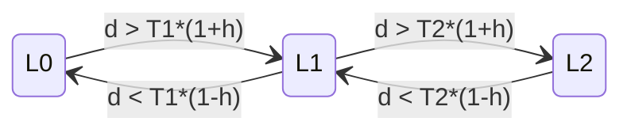
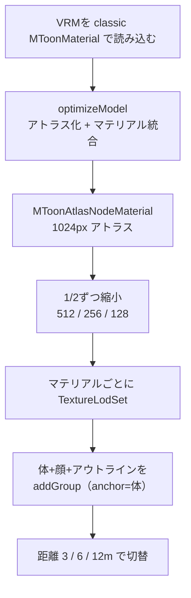

# three-texture-lod

three.js 向けの距離ベース・テクスチャ LOD ライブラリ。カメラ距離に応じて
マテリアルバリアントを差し替え、遠くのオブジェクトほど低解像度テクスチャで描画する。
`WebGPURenderer`（WebGPU / WebGL2 フォールバック）で動作する。
複数メッシュ・複数マテリアルを同じ距離で切り替える `addGroup` と、
VRMアバターを実行時に最適化してLOD化するデモを含む。

## 方式

解像度の異なる別テクスチャをレベルごとに持ち、カメラ距離に応じて
事前生成したマテリアルバリアントを `mesh.material` へ代入して切り替える。
テクスチャ差し替えではなくマテリアル差し替えにする理由は、
描画パイプライン（シェーダ）をレベル間で共有し、切替時の再コンパイルをなくすためである。

### パイプライン共有の実測結果

デモ（60板・3レベル）で `renderer._pipelines` を観測した実測値（webgpu / webgl 共通）。
基準値は LOD無効の新規ページ（`?lod=0`、ベースマテリアルのみ描画）で数フレーム後に取得し、
有効化後・近↔遠往復後と比較する（caches はページ内でリセットできないため別ページで測る）。

| 時点 | `caches` | `programs.fragment` |
| --- | --- | --- |
| LOD無効時の基準値 | 2 | 2 |
| LOD有効化後（全板に再付与） | 2 | 2 |
| 近↔遠往復後 | 2 | 2 |

切替前後で増加なし。レベルごとにマテリアル実体は別だが、
テクスチャ解像度の違いはパイプラインを分けないことが確認できる。

## 使い方

```ts
import { WebGPURenderer } from 'three/webgpu';
import { MeshStandardMaterial } from 'three/webgpu';
import { createTextureLodSet, TextureLodManager } from 'three-texture-lod';

const renderer = new WebGPURenderer({ canvas, antialias: true });
await renderer.init();

// 解像度の異なる3枚を用意する（色空間・ラップ等の設定は全レベルで統一）。
const base = new MeshStandardMaterial({ map: textureHi, roughness: 0.85 });

const set = createTextureLodSet({
  material: base,
  levels: [
    { distance: 0, textures: { map: textureHi } },
    { distance: 10, textures: { map: textureMid } },
    { distance: 25, textures: { map: textureLow } },
  ],
  hysteresis: 0.1,
});

const manager = new TextureLodManager({ distanceMode: 'surface', residency: 'evict' });
manager.add(mesh, set);

// 1つの距離で複数メッシュ・複数マテリアルを連動させる場合（VRMの体+顔+アウトラインなど）。
// 全セットの距離境界とヒステリシスは一致させること。remove はグループ全体を解除する。
manager.addGroup(
  [
    { mesh: bodyMesh, set: bodySet },
    { mesh: faceMesh, set: faceSet },
  ],
  { anchor: bodyMesh },
);

// 毎フレーム、描画前に更新する。
manager.update(camera);
renderer.render(scene, camera);
```

`three-texture-lod` は npm 公開していない private パッケージのため、
利用側では workspace 参照または `file:` 依存で `dist/lib` を参照する。
配布物は `pnpm build:lib` で `dist/lib/` に生成する（JS + 型宣言）。

```sh
pnpm build:lib   # dist/lib/three-texture-lod.js + dist/lib/index.d.ts を生成
pnpm build:all   # デモ（dist/demo/）とライブラリ（dist/lib/）を両方生成し、共存させる
```

## API要約

- `createTextureLodSet(options)` / `TextureLodSet` — 1メッシュ分のLOD定義。
  レベルごとにバリアントマテリアルを事前生成する。`variant(level)` で取得、
  `syncFromBase()` で後付けの材質変更を全バリアントへ反映、`dispose()` で破棄。
  スロット名はマテリアル型の `Texture | null` プロパティから導出するため、
  MToon の `shadeMultiplyTexture` なども `as` なしで指定できる。
- `TextureLodManager` — 複数メッシュのレベル判定と常駐管理。
  `add(mesh, set)` / `addGroup(bindings, { anchor })` / `remove(mesh)` /
  `update(camera)` / `levelOf(mesh)` / `stats()` / `dispose()`。
  `addGroup` は複数メッシュを1つの距離で連動させ、統計もグループ単位になる。
- `selectLevel(previous, distance, thresholds, hysteresis)` — ヒステリシス付き判定の純粋関数。
- `computeLodDistance(object, camera, mode)` — 中心距離（`center`）または
  バウンディング球表面からの距離（`surface`、0クランプ）を返す。

## ヒステリシス

境界を `T[i]`（`T[0] = 0`、狭義単調増加）、幅を `h`（`0 <= h < 1`）とする。
初回は `d >= T[i]` を満たす最大の `i` を選び、以降はバンド端を越えた分だけ移動する。

- 上方向: `d > T[level+1] * (1 + h)` の間 `level++`
- 下方向: `d < T[level] * (1 - h)` の間 `level--`



バンドが重ならない条件（`T[i]*(1+h) < T[i+1]*(1-h)`）はセット生成時に検証し、
重なる定義は `Error` で拒否する。

### 設定値の意味

| 設定 | 既定 | 意味 |
| --- | --- | --- |
| `hysteresis` | `0.1` | 境界付近のちらつき抑止幅。`0` で単調なしきい値判定になる |
| `distanceMode` | `'surface'` | `'surface'` は球半径を差し引く。大きな板が目の前にあっても粗LODに落ちない |
| `residency` | `'evict'` | `'evict'` は未使用テクスチャを破棄、`'keep-all'` は全保持 |
| `evictDelayMs` | `5000` | `evict` 時の最終使用からの猶予。`0` で即時破棄 |
| `now` | `performance.now` | 時刻源。テストで時間を操作するための注入点 |

### evict の補足

- 最粗レベル（L2）は常駐（pin）し、破棄対象にならない。遠景でも描画が欠けない。
- `texture.dispose()` は GPU 側のリソースだけを解放し、CPU 側の `image` は残る。
  近景復帰時は再アップロードが走るため、大きなテクスチャではヒッチし得る。
- LOD管理外のメッシュやベースマテリアルが同じ `Texture` を使っている場合、
  `evict` はそのテクスチャも破棄対象にし得る。管理外の利用があるなら `keep-all` を推奨する。
- 事前に全レベルをアップロードしておくウォームアップAPIは用意していない。

### 距離の測り方

- カメラのワールド位置だけを使い、FOV・ズーム・正射影は考慮しない。
- 基準はバウンディング球。`center` は球中心までの距離、`surface` は球面までの距離（0クランプ）。

## VRMデモ

`vrm.html` は、複数のVRMを読み込み、[avatar-optimizer](https://github.com/WebXR-JP/avatar-optimizer) で
アトラス化・マテリアル統合したうえで、アバター単位でテクスチャLODを適用する実践的なシーン。
体・顔・アウトラインが複数メッシュ・複数マテリアルに分かれても、1体を1グループとして同じレベルで切り替える。



### 起動

```sh
pnpm install
pnpm models:fetch   # AvatarSample_A/B/C を public/models/ へ取得（約42MB）
pnpm dev
# http://localhost:5173/vrm.html
```

モデルはリポジトリに含めない。`public/models/` に自分の `.vrm` を置くか、
デモ画面へドラッグ&ドロップしてもよい（ソースは最大4体、複製込みの総数は最大12体）。
サンプルのライセンスは [public/models/README.md](public/models/README.md) を参照。

URLパラメータ: `?models=A,B,C`（読み込むモデル。ソースは最大4）、`?avatars=4`（総体数、既定4、最大12）、`?backend=webgl`、
`?lod=0`（LOD無効）、`?h=0.15`、`?atlas=1024`、`?auto=0`（自動カメラ停止）、
`?residency=keep-all`、`?evictDelay=1000`。

### 方式

- 読み込みは **classic MToonMaterial**。three r187 では three-vrm の `MToonNodeMaterial` が
  `transformedNormalView` を要求してバンドルできないため、最適化後の描画だけを
  `@webxr-jp/mtoon-atlas/nodes` の `MToonAtlasNodeMaterial`（TSL）へ置き換える。
  classic のマテリアルは最適化で全て置き換わるので、WebGPURenderer では描画されない。
- アトラスは `map` / `shadeMultiplyTexture` / `normalMap` / `emissiveMap` などの
  使用スロットだけを実サイズで作り、未使用スロットは 8px に落とす。
- 各スロットを 1/2 ずつ縮小して **1024 → 512 → 256 → 128** の4レベルを作る。
  色は sRGB をリニアへ戻して平均し、RGB はアルファで重み付け、法線は再正規化する。
  全レベルにミップマップを付け、切替時のちらつきを抑える。
- 距離境界は `surface` で **3 / 6 / 12m**、`h=0.15`。初期構図（`?auto=0`）では4体を
  2.7 / 5.3 / 10.7 / 16.3m に置き、L0 / L1 / L2 / L3 が同時に確認できる。
- 1体につき最大4マテリアル（opaque / alphaTest / transparent + アウトライン）が
  同じアトラステクスチャを共有する。`addGroup` で全メッシュを1レベルに同期させることで、
  顔だけ先に粗くなる逆転と、参照カウントのずれを防ぐ。
- HUDの `models` 行は `sources 3 / avatars 4 (clones 1)` のように、
  最適化したソース数と、複製込みの総体数を分けて出す。
  最適化・メッシュ・マテリアルの集計はソースのみで、複製のゼロ値は足さない。
  `meshes` 行の `(rendered N)` は全ハンドルのメッシュ合計である。

### 最適化済みモデルの複製で体数を増やす

- `?avatars=N` で総体数を指定する（最大12、既定4）。
  読み込むソースは `?models` の先頭から `min(4, avatars)` 体までで、足りない分は
  最適化済みモデル（テンプレート）の複製で補う。
  既定は `?models=A,B,C` + `?avatars=4`（3ソース + Aの複製1体）。
  `?models=A,B,C,A&avatars=4` なら従来どおり4ソースになる。
- GUIの「複製を追加」/「複製を削除」で体数を増減できる。
  追加はインスタンスが最も少ないテンプレートを複製し、削除は最後の複製を外す。
- 複製は最適化を再実行せず、アトラス・テクスチャ・マテリアル・LODセットを
  テンプレートと共有する。メッシュと束縛だけを複製ごとに持つため、
  複製を増やしても `Too many active WebGL contexts` 警告は出ない。
- `?avatars` を省略した場合は4。`?models=A,B` のようにソースが4未満でも、
  複製で4体まで補う。`?avatars=1` にすると最初のソース1体だけになる。
- 5体以上では3Dラベルは先頭4体のみ表示し、残りはHUDの行で確認する。
  12体では5体目以降が遠景のL3になる（負荷・共有の確認向け）。
- ソース上限（最大4）は、最適化時に avatar-optimizer がアトラス合成のたび
  一時 `WebGLRenderer` を作るため。複製はこの上限と無関係である。
- 複製は最適化済みシーンの bone を clone するため、VRM の Humanoid / SpringBone /
  ExpressionManager は持たない。rest pose と頭ボーンの揺らしのみで、髪の物理・
  瞬き・表情は静的になる。フル動作が必要なモデルはソースとして読み込む（上限4）。

### 実測（WebGPU / WebGL2）

1024px アトラスの実測（4ソース・WebGPUを基準に、複製・既定値を併記）:

| 項目 | 値 |
| --- | --- |
| 最適化前 → 後（4体合計） | mesh 409 → 48、material 298 → 16 |
| アトラス全解像度 | 53.3 MB |
| LOD有効時の推定常駐（L0/L1/L2/L3 が1体ずつ） | 18.3 MB |
| 1体スモーク: evict 近景 → 遠景 → 復帰 | 約14 MB → 0.21 MB → 約14 MB |
| 復帰時の中央領域輝度比 | 1.004〜1.005（`|ratio-1| < 0.1`） |
| パイプライン（1体、L0↔L3 を複数往復） | caches 12 → 12、fragment 12 → 12 |
| ヒステリシス（1体） | 12点系列＋上側バンド保持3点が一致、バンド内6往復で切替0、h=0 で10回切替 |
| 実GPUテクスチャ数（1体、近景→遠景） | 21 → 17（evictで実際に減少） |
| 複製時（ソース1 + 複製3、L0/L1/L2/L3 が1体ずつ） | 最適化1回、常駐はソース1体分の約1.33倍 |
| 既定（3ソース + 複製1） | mesh 319 → 36（rendered 48）、material 272 → 12、atlas 40.0MB、常駐 18.1MB |
| 12体（4ソース + 複製8） | rendered 144 mesh、常駐 18.3MB、警告0 |

### 注意

- **ソースは最大4体、複製込みの総数は最大12体**。avatar-optimizer はアトラス合成のたびに一時 `WebGLRenderer` を作るため、
  WebGL では4ソースの最適化でもコンテキスト上限に触れて `WebGL Device Lost` になることがある
  （WebGPUでは4ソースを検証済み）。既定の3ソース + 複製を推奨する。
  複製は最適化を再実行しないため、この上限と無関係である。
- `matcap` はUV非依存なのでLOD対象外（元テクスチャのまま）。
- 最粗128pxではアトラスのパディングがないため、隣接するUV島の色が滲む可能性がある。
  髪やまつげのアルファテストは最粗レベルで目視確認すること。
- `materialColorBind` / `textureTransformBind` は最適化前のマテリアルを参照するため、
  最適化後は効かない（LODとは別の既存制約）。
- アバターの `SkinnedMesh.boundingSphere` はスキニング後の頂点から計算され、
  実体より大きくずれる（実測 r=2.36、geometry は 0.85）。デモでは距離とカリングを
  bind pose の geometry 球に固定している。
- サンプルモデルは CC0 ではない。利用条件は [public/models/README.md](public/models/README.md)。

## 制限

- 判定はオブジェクト単位。`InstancedMesh` のインスタンス単位LODには非対応
  （メッシュ全体の球で1レベルに決まる）。複数メッシュをまとめる場合は `addGroup` を使う。
- LOD対象スロットはマテリアル型の `Texture | null` プロパティから導出する。
  `colorNode` 等で独自に `texture()` を組んでいるマテリアルは自動LOD化できないため、
  `createVariant` フックでレベルごとのノードを組み直す。
- 圧縮テクスチャの可否はバックエンド依存。レベル間で色空間・フィルタ等の
  設定がずれると警告（`console.warn`）を出す。解像度以外の見え方は統一すること。
- `residentBytes` は RGBA8・ミップマップ係数 4/3 の推定値であり実測ではない。
- デモの `_pipelines` 観測はデバッグ用の内部アクセスであり、公開APIではない。
  three の更新で構造が変わる可能性がある。

## デモ

```sh
pnpm dev            # 動作確認（ブラウザで開く）
pnpm build          # デモアプリを dist/demo/ に出力（dist/lib は残る）
pnpm build:lib      # ライブラリを dist/lib/ に出力（デモは残る）
pnpm build:all      # デモとライブラリの両方を生成し、dist/ 配下に共存させる
pnpm models:fetch   # VRMデモ用のサンプルモデルを public/models/ へ取得
```

- 板ポリのLODデモ: `http://localhost:5173/index.html`
- VRMデモ: `http://localhost:5173/vrm.html`（`pnpm models:fetch` が必要）

板ポリのデモでは、右上の lil-gui と左上の HUD で操作・観測する。

| 操作 | 内容 |
| --- | --- |
| `autoMove` / `speed` | カメラの自動往復（z: 6 → -70 → 6）と速度 |
| `hysteresis` / `residency` / `evictDelayMs` / `distanceMode` | 設定を丸ごと再構築（カウンタはリセット） |
| `LOD有効` | 全meshの登録／解除（解除時はベースマテリアルに戻る） |
| `近距離へ` / `遠距離へ` | カメラを z=0 / z=30 へ即時移動 |
| `h=0で往復テスト` | ヒステリシスなしで境界 T=10 / 25 を往復 |

URLパラメータ: `?backend=webgl`（WebGL強制）、`?auto=0`（自動移動OFF）、
`?h=0.2`（作成時h）、`?residency=keep-all`、`?z=-30`（初期カメラz）、
`?lod=0`（LOD無効で起動。ベースマテリアルのみ描画）。

## スモーク

```sh
pnpm smoke          # build済み前提。preview起動→検証→kill
```

Playwright（`playwright-core`）が headed Chrome を起動し、
webgpu / webgl の両バックエンドで以下を検証する。
待機は `stats().frame` の進行＋条件ポーリングで行い、固定sleepに依存しない。

1. `__lodDemo.ready` の待機、pageerror / console.error の収集
2. パイプライン基準値を LOD無効の新規ページ（`?lod=0`）で取得し、
   有効化後・近↔遠往復後も `caches` / `fragment` が増えないこと
3. 近距離で `L0` と `L2` が混在し、遠距離で全板が `L2` になること（stats整合つき）
4. ヒステリシス厳密検証（h=0.2, center）:
   `5→L0`, `12.1→L1`, `9→L1`, `7.9→L0`, `9→L0`, `11.9→L0`, `12.1→L1`
   （同じレベルが続くケースもフレームを進めてから読む）
5. バンド内往復（`9.5↔10.5` を10往復）で切替0、対照の h=0 はプローブ単体の系列
   `9.9→L0`, `10.1→L1`, `9.9→L0`, `10.1→L1` で追従すること（`switchCount` は参考記録のみ）
6. テレポート: L0から `setProbeDistance(40)` 1回で frame+2 以内に L2（frame差分を記録）
7. `evict` 即時破棄で `residentBytes` が半分未満に減り、
   近景の中央領域の画素輝度が背景より十分明るい（`> 30`）こと、
   復帰時は `|recovered / near - 1| < 0.1` の両側判定を満たすこと（pngjsで実描画をassert）。
   遠方の輝度は記録のみ
8. `keep-all` では遠ざけても `residentBytes` が減らないこと
9. 近距離・遠距離・evict前後のスクリーンショット保存（`artifacts/`）

結果は JSON で標準出力し、失敗時は exit 1。出力にはパイプライン数、輝度、
`residentBytes`、レベル分布、h=0 / h=0.2 の切替回数を含める。
表示できない環境では
`xvfb-run -a pnpm smoke` のように Xvfb 経由で実行する。
Chrome のパスは `CHROME_PATH` 環境変数で上書きできる
（既定: `/run/current-system/sw/bin/google-chrome`）。

### VRMデモのスモーク

```sh
pnpm models:fetch   # 初回のみ
pnpm build          # public/models を dist/demo へコピー
pnpm smoke:vrm      # WebGPU / WebGL2 の両方
```

1体（`?models=A&avatars=1`）を読み込み、最適化前後のメッシュ・マテリアル数、LODセット数、
アトラス解像度・使用スロット、バリアントの実テクスチャ幅（1024/512/256/128）を確認する。さらに
ヒステリシス12点の系列とメッシュ間の同期、バンド内往復で切替0、h=0の境界往復、
L0↔L3 を繰り返した後のパイプライン非増加、
`evict` の常駐減（実GPUテクスチャ数も確認）と画素輝度の復帰、
`keep-all` の非減、コンソール/GPU警告0を検証する。
続けて既定（`?auto=0`、3ソース + 複製1）を読み込み、`sourceCount=3` / `cloneCount=1`、
初期レベル `[0,1,2,3]`、最適化回数3、複製の `optimizeMs=0`、メッシュ内レベル同期、
読み込み失敗0、コンソール/GPU警告0を検証する。さらに複製（`?models=A&avatars=4&auto=0`）で
`sourceCount=1` / `cloneCount=3`、最適化回数1、常駐がソース1体分の1.5倍未満、
raw 頭ボーンの揺れ（SkinnedMesh の skeleton 所属と角度差）、追加/削除、h変更後の再バインドを検証する。
4ソース（`?models=A,B,C,A&avatars=4&auto=0`）は WebGPU でのみ検証する
（WebGLは4ソース最適化のコンテキスト上限のためスキップし、既定3ソース+複製で見る）。
スクリーンショットは `artifacts/vrm/` に保存する。
